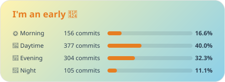

# 🔥 Hi, I'm DooYee! Nice to meet you! 🔥

### 🚀 About Me
- 🎓 B.E. in Computer Engineering, Myongji University (MJU) | Aug 2026
- 📚 Driven by a passion for continuous learning & full-stack software engineering

> 🔗 **[Explore My Interactive Portfolio & DevLog ↗](https://dooyee.dev)**

## 🛠️ Technologies

### 📌 Languages


### 🖥️ Frameworks & Libraries

 <br/>


### 💾 Data & Search


 <br/>


### ☁️ Cloud & DevOps


### 🎮 Game Engine


### 🛠️ Tools & Collaboration

 <br/>


---

### 📊 Stats


<!-- GIST-PRODUCTIVE:START -->
[](https://gist.github.com/DOOYEE0709/35d87951dac97313c4d7fc436c18ef0c)
<!-- GIST-PRODUCTIVE:END -->

<!-- GIST-STATS:START -->
**[DOOYEE's GitHub Stats](https://gist.github.com/DOOYEE0709/bf3bbf4683d899681c691c81caacb2a3)**
```text
⭐    Total Stars:                                1
➕    Total Commits:                          1,428
🔀    Total PRs:                                142
🚩    Total Issues:                              92
📦    Contributed to:                            21
```
<!-- GIST-STATS:END -->

### 📫 Contact ME
[](mailto:somewhere.dooyee@gmail.com)
